# AMME5710 Volleyball Line Judge

A low-cost computer vision referee assistant for amateur indoor volleyball. Two phones on tripods,
one behind each end line, record the match. From those two videos the system finds the court,
syncs the cameras by sound, tracks the players and the ball in 3D, calls each bounce IN or OUT,
predicts the landing spot while the ball is still in the air, works out who touched the ball, and
checks the 3-touch and double-contact rules. No calibration target and no learned ball detector
are used.

AMME5710 Computer Vision and Image Processing, Major Project 2026, University of Sydney.

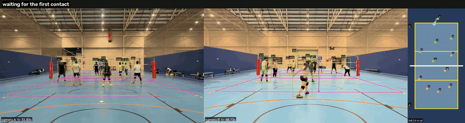

*Both synced cameras and a top-down court map. Orange = camera A's half, green = camera B's. The
top bar shows the rally and hit count; contacts are labelled with team, hit number and player
("A2 #5"); the dashed line is the predicted flight and "pred IN" the predicted landing; the dot
at the bounce is the measured call.*

**Full 2-minute demo video:** [docs/media/full_pipeline_30to150s.mp4](docs/media/full_pipeline_30to150s.mp4)
(Game 2, 30-150 s, every stage running together).

---

## Contents
1. [How it works](#how-it-works)
2. [Results](#results)
3. [Quick start](#quick-start)
4. [Setup](#setup)
5. [Data and coordinate frame](#data-and-coordinate-frame)
6. [Pipeline, step by step](#pipeline-step-by-step)
7. [Synthetic test with exact ground truth](#synthetic-test-with-exact-ground-truth)
8. [Earlier work: court detection on broadcast footage](#earlier-work-court-detection-on-broadcast-footage)
9. [Limitations and next steps](#limitations-and-next-steps)
10. [Repository layout](#repository-layout)

---

## How it works

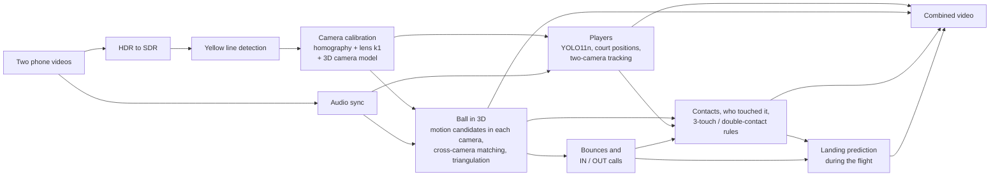

The key idea is that **the second camera replaces a learned detector**. Each camera alone finds
many moving blobs; only the real ball gives rays from both cameras that meet in 3D, follow
gravity, and have the right size for a 21 cm ball at that distance. Once the ball is in 3D, a
contact is a sudden change in velocity between two gravity arcs, a bounce is where the arcs meet
the floor, and a landing prediction is the arc fitted so far extended to the floor.

---

## Results

All real-footage numbers are from "Game 2" (two iPhones, 1920x1080; camera A at 29.97 fps, camera B at 59.9 fps).

| Stage | Result | How it was measured |
|---|---|---|
| Court lines and calibration | 6.3 cm (camera A), 2.8 cm (camera B) | Each court line left out of the fit in turn and checked in centimetres |
| Audio sync | +9.71 s offset, 6 of 8 chunks agree; refined to 1 ms on synthetic | Independent 30 s chunks voting; synthetic clip with a known offset |
| Player detection | F1 0.93, median position error 0.25 m | 105 hand-clicked players at 10 moments, YOLO11n with fitted foot correction |
| Ball in 3D | 1.6-2.6 cm median 3D error, no false 3D points (synthetic); real play: 3D on 1180 of 3597 frames (33 %) over 2 minutes, which includes the dead time between rallies; median reprojection error 1.4 px | Synthetic ground truth; real coverage |
| Line calls | 2 of 3 synthetic serves found and called correctly (0.4 and 6.6 cm across the line); the 3rd (2 cm from the line) was missed by the ball tracker | Synthetic ground truth |
| Contacts and who touched them | 25 contacts and 9 bounces in 2 minutes; 18 contacts attributed to a player (13 with a confident team, 5 `TEAM_GUESSED`), 7 not attributed | Real footage, checked visually from the evidence images; not yet scored against hand labels |
| Landing prediction | 2-10 cm after 25-75 % of the flight (synthetic); 0.5-2 m on real footage, every call right | Synthetic ground truth; real bounces measured by the system itself |
| Rules (4 touches, double contact, block) | Correct on constructed sequences | No fouls happened in the footage |
| Broadcast court detection (earlier work) | 5.8 cm mean error, 11-15 ms per frame | 15 hand-labelled frames across zoom levels |

---

## Quick start

After [setup](#setup), with the Game 2 videos in `data/`:
```
python scripts/run_pipeline.py --start 30 --duration 120
```
This runs every analysis step on 30-150 s of the match and writes one video with everything:
`results/full/game2_A_game2_B_sdr_full_from30.mp4`. The calibrations and audio sync are already
in `data/annotations/`; steps 1-5 below are only needed for new footage. Each step is skipped if
its output exists; `--redo touches` re-runs from that step on, `--redo all` re-runs everything.

Time on our development PC (CPU only) for 2 minutes of video: about 70 minutes (players 17 min, 3D ball 47 min, line calls 12 s, touches 2.6 min, landing prediction 4 s, video 2.2 min).

---

## Setup

Python 3.11 recommended.

**Windows (PowerShell)**
```
py -m venv .venv
.venv\Scripts\activate
python -m pip install --upgrade pip
pip install -r requirements.txt
```
If activation is blocked: `Set-ExecutionPolicy -Scope CurrentUser RemoteSigned`, then activate again.

**Mac / Linux**
```
python3 -m venv .venv
source .venv/bin/activate
python -m pip install --upgrade pip
pip install -r requirements.txt
```

`requirements.txt`: `numpy`, `scipy`, `opencv-contrib-python`, `matplotlib`, `imageio-ffmpeg`,
`ultralytics`.
- `imageio-ffmpeg` provides ffmpeg (with the `zscale` filter needed for HDR conversion), so ffmpeg
  doesn't need to be installed separately.
- `ultralytics` provides YOLO and installs PyTorch (the CPU version is fine). The weights
  (`yolo11n.pt` for players and ball masking, `yolo11m-pose.pt` for touches) download
  automatically on first use and are ignored by Git.
- Use `opencv-contrib-python`, not `opencv-python`: OpenCV 5 moved the HOG people detector to the
  contrib package. Don't install both. If you have `opencv-python`:
  `pip uninstall -y opencv-python`, then `pip install -r requirements.txt`.

Run all commands from the repo root with the environment activated.

---

## Data and coordinate frame

Videos are **not** in Git (GitHub rejects files over 100 MB).

| Folder | In Git? | Contents |
|---|---|---|
| `data/` | No | Videos: `data/game2_A.mp4`, `data/game2_B_sdr.mp4` |
| `data/annotations/` | **Yes** | Calibrations, sync offset, hand-clicked ground truth, fitted foot offset, ball image patch |
| `docs/media/` | **Yes** | Figures and the demo video used in this README |
| `frames/`, `results/` | No | Frames, debug images, videos and CSVs written by the scripts |

**Game 2:** two iPhones on tripods, one behind each end line of an indoor court with yellow
volleyball lines on a blue floor, 1920x1080, camera A at 29.97 fps and camera B at 59.9 fps.

| Camera | File | Position (`--end`) | Notes |
|---|---|---|---|
| A | `data/game2_A.mp4` | behind the y = 18 end line (`near`) | normal (SDR) video |
| B | `data/game2_B_sdr.mp4` | behind the y = 0 end line (`far`) | recorded in HDR, converted with `hdr_to_sdr.py` |

**Court frame (metres), shared by both cameras:** `x` 0-9 across, `y` 0-18 along, `z` up. End
lines at `y = 0` and `y = 18`, attack lines at 6 and 12, net at `y = 9`. Each camera judges the
half nearest to it: A `y = 9..18`, B `y = 0..9`. Team "A" means the team on camera A's half.

For future recordings: turn **HDR Video off** on both phones and record a clap at the start.

---

## Pipeline, step by step

### 1. Inspect each video
```
python scripts/inspect_video.py data/game2_A.mp4 --every 30
```
Prints resolution, frame rate, bitrate and codec, checks for dropped or doubled frames, flags HDR
video, and saves exact frames and a contact sheet to `frames/game2_A/`.

### 2. Convert HDR video to normal colours
```
python scripts/hdr_to_sdr.py data/IMG_4857.MOV data/game2_B_sdr.mp4 --width 1920
```
iPhone HDR (HLG, BT.2020) looks washed out when read as normal video: the floor's saturation
dropped from about 65 to 22. The script converts properly: HLG to linear light (reference white
203 nits, ITU-R BT.2408), BT.2020 to BT.709 primaries, Mobius tone mapping. A round trip (SDR to
HLG and back) recovered the floor colour to within 2 saturation levels (mean pixel difference
3/255, against 13/255 when read naively). `--start 60 --duration 10` makes a quick test with a
before/after image.

### 3. Detect the yellow court lines
```
python scripts/detect_court_lines.py data/game2_A.mp4 --time 60
```
1. **Colour model** measured from the floor at the bottom of the frame, with thresholds relative to
   it, so the same code works on normal and converted HDR footage. Yellow is hue 22-42, which
   excludes the orange lines of other sports (hue 9-20).
2. **Floor mask** (thin lines of other sports bridged by a morphological closing) and **line mask**
   (yellow pixels on the floor, compact blobs such as skin and shoes removed by shape).
3. **Hough transform**, segments grouped by angle into the end line and the two sidelines.
4. **RANSAC line fit** per group (players on the line are outliers), least-squares refit, corners as
   line intersections. The detected line pixels lie within 1-2 px of straight lines.

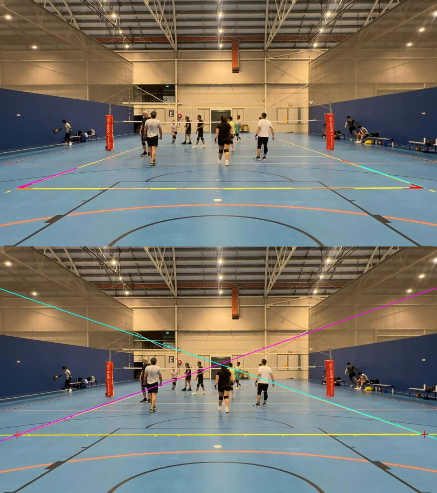

### 4. Calibrate each camera
```
python scripts/calibrate_camera.py data/game2_A.mp4 --camera A --end near --time 60 --auto-lines results/court_lines/game2_A_t60.json
python scripts/calibrate_camera.py data/game2_B_sdr.mp4 --camera B --end far --time 24 --auto-lines results/court_lines/game2_B_sdr_t24.json
```
The detected lines and corners are added automatically; the user clicks the intersections the
detector can't find (attack-line ends, far court) with a 5x magnifier.
- **Fit:** homography (court to image) by robust least squares on the intersections and on the
  distances of line points from their lines, plus a radial lens term `k1`, kept only if it lowers
  the held-out error.
- **Accuracy:** each line is left out of the fit in turn and its points are checked against where
  the line really is, in centimetres on the court (conservative: about twice the true error in
  simulation).
- **Tripod check:** 40 frames through the video are compared with the calibration frame (phase
  correlation of walls and ceiling); a shift over 2 px means the phone moved.
- **3D camera model** (`camera_3d.py`): focal length, rotation and position recovered from the
  homography (principal point at the image centre, square pixels). Checked by drawing the net and
  2 m poles, which the floor calibration never saw.

| | Accuracy estimate | Lens k1 | Camera position (x, y, height) | Tripod |
|---|---|---|---|---|
| Camera A | 6.3 cm | -0.021 | 4.6, 24.8, 1.50 m | stable throughout |
| Camera B | 2.8 cm | -0.012 | 4.6, -6.5, 1.36 m | stable from about 7 s |

| Calibration overlay (camera A) | 3D model check: net and 2 m poles (camera A) |
|---|---|
|  | 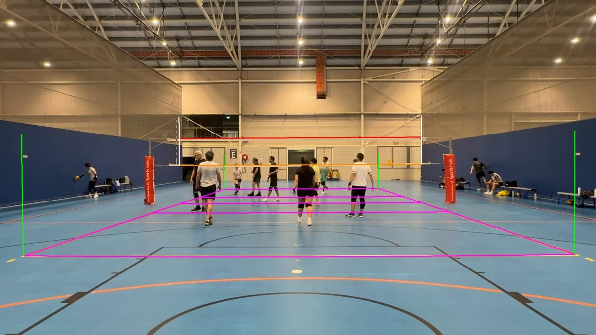 |

### 5. Sync the two cameras by sound
```
python scripts/sync_videos.py data/game2_A.mp4 data/game2_B_sdr.mp4
```
Both phones hear the same whistles and ball contacts. Each soundtrack becomes a multi-band onset
signal (rises in log energy in five frequency bands), cross-correlated coarse to fine: blurred at
100 Hz first (sounds reach the phones up to 60 ms apart), then refined at 1 ms. Each lag is scored
as a z-score, and every 30 s chunk votes independently.

**Result:** offset +9.71 s, 6 of 8 chunks agree, one clear peak. The ball step (9) refines it
further to the millisecond.

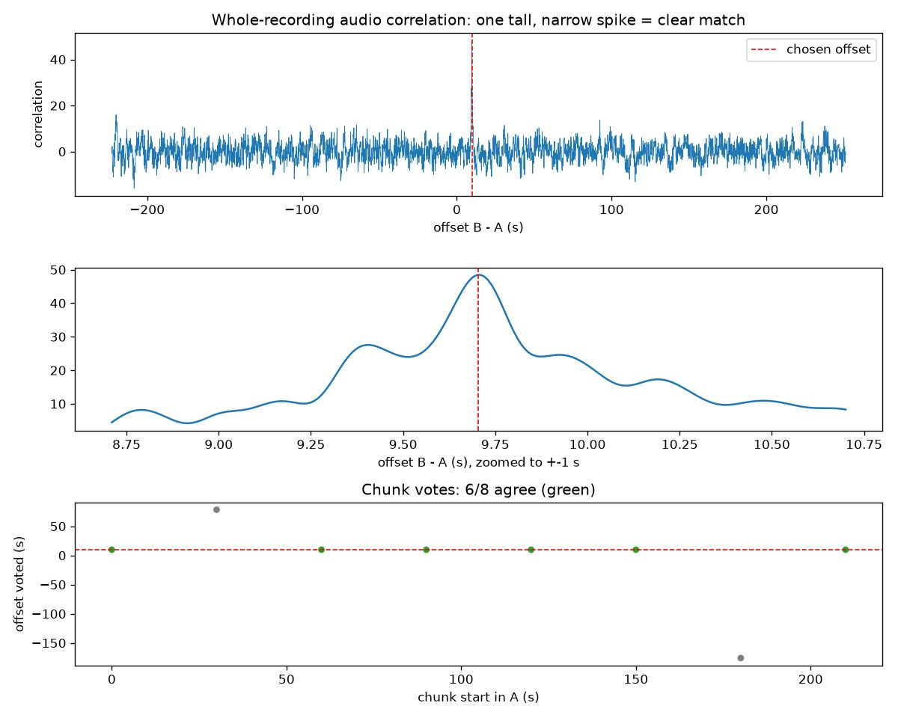

### 6. Player detection and court positions
```
python scripts/players_on_court.py data/game2_A.mp4 data/game2_B_sdr.mp4 --calib-a data/annotations/calib_A.json --calib-b data/annotations/calib_B.json --sync data/annotations/sync_game2_A_game2_B_sdr.json --start 30 --duration 120
```
1. **Detection:** YOLO11n (pretrained COCO `person`) on both cameras every 3rd frame (HOG + SVM
   with `--detector hog` for comparison).
2. **Foot point:** bottom centre of the box, raised by a fitted 5.3 % of the box height (step 7);
   only the feet are on the floor, so only they map correctly through the floor homography.
3. **Court position** in metres; people off the court (benches, spectators) are dropped.
4. **Fusion:** each camera covers its own half; within 1 m of the net both are used and matching
   detections are averaged.
5. **Tracking in court coordinates:** constant velocity, Hungarian assignment, 1.5 m gate, 3 hits to
   confirm a track.

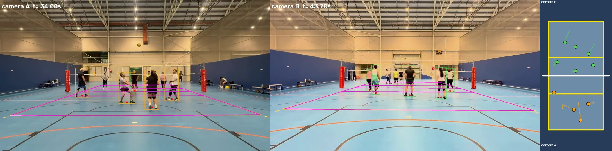

### 7. Player detection accuracy
```
python scripts/eval_players.py annotate ...    # hand-click players at 10 moments (saved, committed)
python scripts/eval_players.py evaluate
```
105 hand-clicked players at 10 moments; a detection is correct within 1.0 m (one-to-one).

| Detector | Foot point | Precision | Recall | F1 | Median error | Time, both cameras |
|---|---|---|---|---|---|---|
| HOG + SVM | raw | 0.03 | 0.02 | 0.02 | 0.62 m | 446 ms |
| HOG + SVM | corrected (13.6 %) | 0.71 | 0.50 | 0.58 | 0.51 m | 446 ms |
| YOLO11n | raw | 0.67 | 0.69 | 0.68 | 0.66 m | 264 ms |
| **YOLO11n** | **corrected (5.3 %)** | **0.94** | **0.91** | **0.93** | **0.25 m** | **264 ms** |
| YOLO11s | raw | 0.67 | 0.73 | 0.70 | 0.65 m | 631 ms |
| YOLO11s | corrected (5.6 %) | 0.94 | 0.95 | 0.94 | 0.25 m | 631 ms |

- The **foot correction** is the biggest single improvement (F1 0.68 to 0.93): the box bottom is
  about 10 px below the feet, which at these shallow angles is 0.66-0.84 m on the court. It is
  fitted with 2-fold cross-validation; both folds gave 5.3 %.
- YOLO11s is barely better at 2.4x the cost, so YOLO11n is used. HOG misses small, distant and
  crouching players.

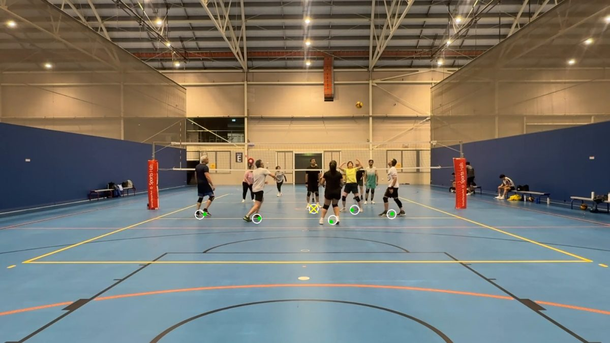

### 8. Ball in 3D from both cameras
```
python scripts/ball_two_cameras.py data/game2_A.mp4 data/game2_B_sdr.mp4 --calib-a data/annotations/calib_A.json --calib-b data/annotations/calib_B.json --sync data/annotations/sync_game2_A_game2_B_sdr.json --start 30 --duration 120
```
- **Each camera** (`ball_detect.py`): three-frame difference (frames a fixed *time* apart, so 30 and
  60 fps behave the same), morphology, then size (the ball's possible image size from the 3D
  camera model), shape (up to 5:1 for motion blur), ball colour, person boxes, isolation.
  Candidates are linked into 2D tracklets.
- **Both cameras:** every pair of overlapping tracklets is triangulated (camera B interpolated to
  each camera A frame time). A pair is the ball only if the rays meet (< 12 px) on 10+ frames, it
  moves (median >= 3 m/s), follows a fixed-gravity parabola within 3 cm, is ball-coloured, and its
  blob size matches a 21 cm ball at the triangulated distance (0.6-2.5x). The size test is the
  strongest: two unrelated blobs triangulate to the wrong distance.
- **Sub-frame sync:** the audio offset is refined on the accepted pairs (2 ms steps).

| Both views with the 3D ball, top and side views | Height over time |
|---|---|
| 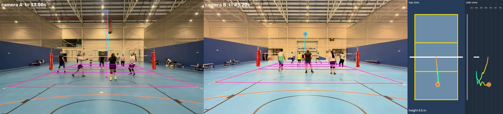 | 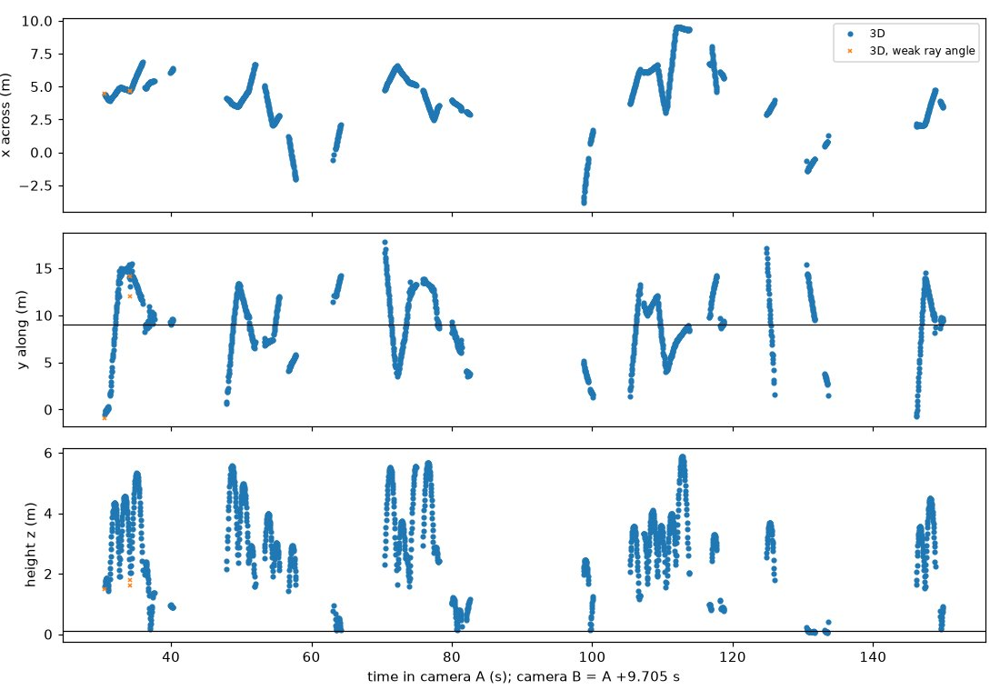 |

### 9. Bounces and IN / OUT calls
```
python scripts/line_calls.py results/ball/game2_A_game2_B_sdr_ball_from30.json
```
1. Bounce candidates: low points (< 0.45 m) where the ball stops descending.
2. Contact point: gravity arcs fitted to up to 0.4 s before and after (weighted by ray angle);
   contact is where the ball centre is one radius (0.105 m) above the floor.
3. Uncertainty from the fit, separately across and along the court, plus 5 cm of calibration error.
4. Call (FIVB: lines are in): IN if the 3 cm contact patch reaches the line; "close" under 2 sigma.
5. A bounce seen by one camera only is located from that camera's ray at ball-radius height.

| Calls on the court (2-sigma circles) and height plot | Replay at the bounce, both cameras |
|---|---|
| 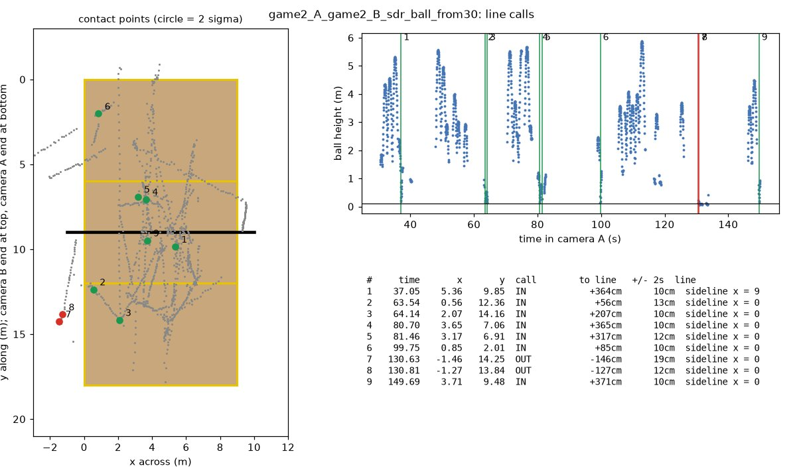 | 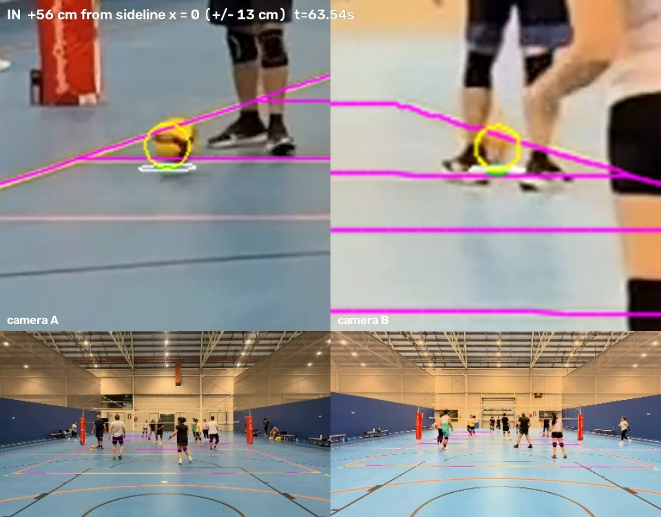 |

### 10. Touches, who touched the ball, and the rules
```
python scripts/touches_rules.py results/ball/game2_A_game2_B_sdr_ball_from30.json --players results/players/game2_A_game2_B_sdr_players_from30.csv
```
1. **Contacts:** between touches the ball follows a gravity arc. At every 3D sample, arcs fitted to
   the 0.3 s before and after are compared; a velocity change over 4 m/s is a contact, placed where
   the two arcs meet. Across gaps in the track the arcs either side are extended: a smooth join
   means no contact, a kink places one, no meeting marks a possible unseen contact.
2. **Who touched it:** the 3D contact point is projected into both cameras at the frames around it.
   YOLO11m-pose runs on a crop of about 4 x 5 m around it, so distant players are big enough. The
   toucher is the person whose hands (wrist + 0.35 forearm), forearms or head are within 0.3 m of
   the ball's surface, **and** whose feet are within 1.8 m of the ball on the court. The second test
   removes players who only overlap the ball in the image (e.g. across the net). For high balls the
   player may be jumping, so the feet may be up to 0.6 m above the floor along the camera ray; if
   that leaves the side of the net ambiguous, the team is guessed and marked `TEAM_GUESSED`.
3. **Rules (FIVB):** a rally starts at a serve or the first contact after a dead ball, and ends at
   a bounce or when the ball is unseen for 2 s. Possession changes when the other team touches the
   ball or the 3D track crosses the net. Blocks don't count as a hit. `FOUR_TOUCHES` and
   `DOUBLE_CONTACT` (same track ID twice, not after a block) are flagged only when the ball was seen
   throughout (no gap over 0.5 s), so a hidden touch can't cause a false foul. A bounce IN gives the
   point to the other side; OUT to the opponents of the last team to touch it.

**Result (Game 2, 30-150 s):** 25 contacts, 9 bounces and 7 rallies. 18 contacts were attributed to
a player: 13 with a confident team and 5 marked `TEAM_GUESSED` (jumping at the net). 7 had nobody
within reach, mostly balls high above the net or hidden by players. In the evidence images most
attributed contacts show the ball at the chosen player's hands or forearms, but this has not been
scored against hand labels. No fouls occurred, so the 4-touch, double-contact and block logic was
checked on constructed sequences instead (4 hits, the same player twice, a block followed by 3 hits
and a touch by the blocker, and a hidden stretch that must not raise a foul); all were correct.

| Every event over time (team + hit number) | Evidence: the crop and skeleton used for each contact |
|---|---|
| 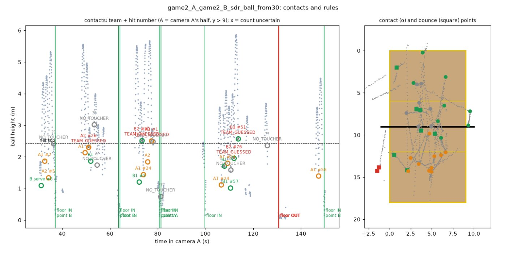 | 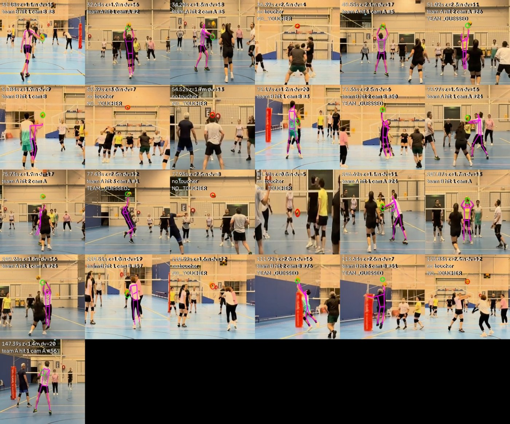 |

### 11. Landing prediction during the flight
```
python scripts/landing_predict.py results/ball/game2_A_game2_B_sdr_ball_from30.json
```
At every frame of a flight (from the last contact to the bounce), a gravity arc is fitted to the
3D points seen **so far** and extended to where the ball centre is one radius above the floor. That
gives the predicted landing time and spot, an uncertainty, and an IN/OUT call with the same rule as
step 9. Each prediction is scored against the measured contact point after 25, 50 and 75 % of the
flight.

| Clip | Bounce | Flight | Error after 25 / 50 / 75 % of the flight | Calls |
|---|---|---|---|---|
| Synthetic | serve IN, 2 m inside | 0.95 s | 2 / 7 / 6 cm | right throughout |
| Synthetic | serve OUT, 23 cm out | 0.95 s | 8 / 10 / 9 cm | right throughout |
| Game 2 | 37.05 s, IN | 0.63 s | 235 / 48 / 66 cm | right throughout |
| Game 2 | 64.14 s, IN | 1.15 s | - / 241 / 225 cm | right throughout |
| Game 2 | 80.70 s, IN | 2.72 s | 142 / 142 / 152 cm | right throughout |
| Game 2 | 99.75 s, IN | 1.02 s | 176 / 43 / 20 cm | right throughout |
| Game 2 | 130.81 s, OUT | 0.35 s | - / - / 39 cm | right |
| Game 2 | 149.69 s, IN | 2.27 s | 225 / 216 / 207 cm | right throughout |

"-" = not enough of the flight seen in 3D yet. Of the 9 real bounces, 8 got a prediction (one had
too few 3D samples), and two short ones (0.25 and 0.55 s) only late.

On real footage, 3D noise (5-13 cm per sample) and gaps make early predictions metres off, and the
model has no air drag. Every real bounce so far landed well inside the court, so close calls are
not yet tested.

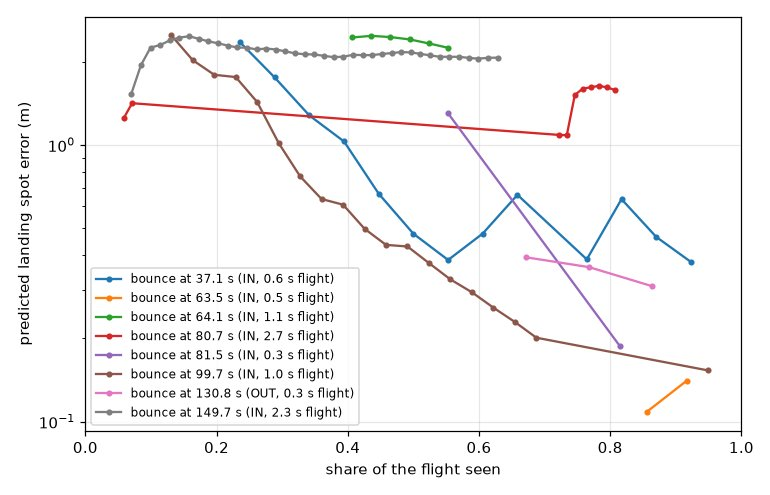

### 12. Everything in one command and one video
```
python scripts/run_pipeline.py --start 30 --duration 120
```
Runs steps 6, 8, 9, 10 and 11, then `render_full.py`, which draws both synced cameras and a court
map with: court lines; players with track IDs (drawn from their court positions); the ball (2D
detection, 3D point and floor shadow); every contact labelled with team, hit number and player;
the predicted path and landing spot during each flight; the measured bounce call; and a top bar
with the rally, "A hit 2/3", fouls and the point.

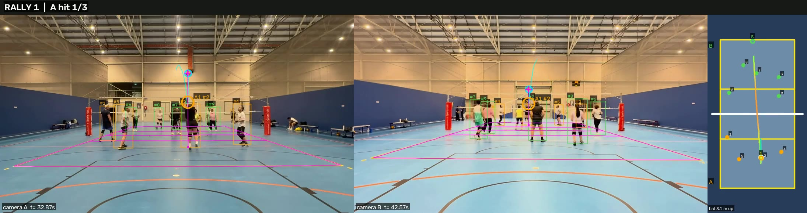

### Utility: click and plot points
```
python scripts/pick_points.py data/game2_A.mp4 --time 60 --names ball landing
```
Saves clicked pixel coordinates with an annotated image, for hand-labelling ground truth.

---

## Synthetic test with exact ground truth

Real games have no ground truth for the ball, so `synthetic_render.py` renders a clip where
everything is known: two virtual cameras placed like ours (exact calibrations), a court, twelve
moving players, a decoy ball, and a ball flying a toss and three serves (IN 2 m inside, OUT 30 cm
outside, and IN with its centre 2 cm outside the sideline). Camera B is shifted by 2.017 s and the
pipeline starts from a 2.000 s guess.
```
python scripts/synthetic_render.py
cd data/synthetic
python ../../scripts/ball_two_cameras.py A.mp4 B.mp4 --calib-a calib_A.json --calib-b calib_B.json --sync sync.json --start 0.3 --duration 7.2
python ../../scripts/line_calls.py results/ball/A_B_ball_from0.3.json
python ../../scripts/synthetic_score.py results/ball/A_B_ball_from0.3.csv results/calls/A_B_ball_from0.3_calls.csv
```

| Measure | Result (current code) |
|---|---|
| 3D ball | 96 of 196 in-flight frames in 3D, median error 2.6 cm, 90th percentile 5.9 cm, no false points |
| Sync refinement | 2.018 s against the true 2.017 s (1 ms) |
| Serve 1, IN (2 m inside) | found, IN, 0.4 cm error across the line |
| Serve 2, OUT (30 cm out) | found, OUT, 6.6 cm error across the line |
| Serve 3, IN (centre 2 cm outside the sideline) | **missed**: the ball tracker didn't keep this flight |
| Landing prediction (serves 1-2) | 2-10 cm error after 25-75 % of the flight, calls right throughout |

An earlier version of the ball tracker found all three serves (errors 1.2, 6.9 and 0.5 cm); the
current one misses serve 3, which needs investigating. Not covered by the synthetic test:
calibration error, audio sync, motion blur, HDR and uneven frame timing.

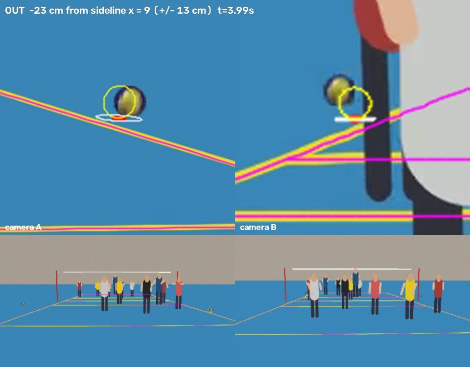

---

## Earlier work: court detection on broadcast footage

Before recording our own footage, the system was developed on a broadcast match (USA vs Brazil)
filmed from behind one end line. White lines on that light floor are nearly invisible (brightness
245 vs 241), so `court_detect.py` uses the colour boundary between the court and the blue free zone:
a free-zone colour model, boundary scanning, vectorised RANSAC line fits for the four edges,
corners from intersections, and a homography to the 9 x 18 m court. The centre and attack lines,
never used in the fit, serve as an independent check.

| Points (15 hand-labelled frames across zoom levels) | Median error | Mean error |
|---|---|---|
| All 6 points | 5.8 cm | 5.8 cm |
| Corners (used by the detector) | 4.7 cm | 6.0 cm |
| Attack-line points (never used by the detector) | 4.9 cm | 5.4 cm |

It runs at 11-15 ms per frame at 960 px (`court_live.py` runs it live with smoothing). It needs a
free zone of a different colour from the court, which is why Game 2 uses line detection instead.

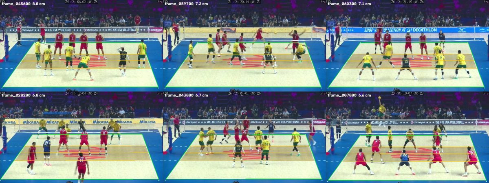

---

## Limitations and next steps

- **Touch detection isn't scored against hand labels yet.** Next: label contacts (time and player)
  on a few rallies with `pick_points.py`.
- **No fouls occurred in the footage**, so the 4-touch, double-contact and block logic is only
  checked on constructed sequences.
- **Close line calls are untested on real footage:** every real bounce landed well inside the court.
- **3D coverage** drops when the ball is near camera height between the cameras (the rays are
  nearly parallel) and when it is hidden by players. Mounting the phones higher, or adding a third
  phone at the side, would help.
- **Synthetic serve 3** (the close one) is missed by the current ball tracker.
- Record at 60 fps with Auto FPS off (camera A's uneven frame timing made one real bounce
  unreliable), add air drag to the landing prediction, and compare the ball detector with
  TrackNetV3.

---

## Repository layout

| Script | Step | Purpose |
|---|---|---|
| `inspect_video.py` | 1 | Video properties, dropped frames, HDR check, frame export |
| `hdr_to_sdr.py` | 2 | iPhone HDR (HLG) to normal video |
| `detect_court_lines.py` | 3 | Automatic yellow court-line detection |
| `calibrate_camera.py`, `camera_3d.py` | 4 | Court calibration, accuracy, tripod check; 3D camera models |
| `sync_videos.py` | 5 | Audio sync between the cameras |
| `players_on_court.py` | 6 | Player detection, court positions, tracking |
| `eval_players.py` | 7 | Player detection accuracy against hand clicks |
| `ball_detect.py`, `ball_two_cameras.py` | 8 | Ball candidates in each camera; 3D ball |
| `line_calls.py` | 9 | Bounces and IN / OUT calls |
| `touches_rules.py` | 10 | Contacts, who touched the ball, 3-touch and double-contact rules |
| `landing_predict.py` | 11 | Landing prediction during the flight |
| `run_pipeline.py`, `render_full.py` | 12 | Everything in one command and one video |
| `synthetic_render.py`, `synthetic_score.py` | test | Synthetic clip with exact ground truth, and its scoring |
| `pick_points.py` | utility | Click and plot points (hand labels) |
| `court_detect.py`, `court_live.py`, `annotate_court.py`, `court_batch_eval.py`, `manual_homography.py`, `court_lines.py` | earlier work | Court detection on broadcast footage |

The contact detection, rules and landing prediction were adapted to the two-camera 3D track from
a teammate's single-camera prototype (ball events, touch attribution, rally rules, landing).
